  <!-- Animated Cloud & Sky Header Banner -->
  

    

  <!-- Quick Badges & Profile Views -->
  
  
  
  
  

---

### ☁️ 01. Overview

**Akkharadech Suphachoktharasap** (`@MIBVI`)  
Computer Engineering Student at **Rajamangala University of Technology Isan (RMUTI)** 🇹🇭  
*Focusing on Web Development, Computer Vision, Embedded IoT (ESP32), and Digital Systems.*

---

### 🌤️ 02. Technical Arsenal

<table align="center" width="100%">
  <tr>
    <td width="33.3%" align="center" valign="top">
       
      <strong>Web &amp; Programming Languages</strong>  
        
      JavaScript &bull; React &bull; HTML/CSS &bull; Python &bull; C / C++
        
    </td>
    <td width="33.3%" align="center" valign="top">
       
      <strong>Embedded Systems &amp; IoT</strong>  
        
      ESP32 &bull; ESP8266 &bull; MicroPython &bull; Sensors
        
    </td>
    <td width="33.3%" align="center" valign="top">
       
      <strong>Cloud, Database &amp; Tools</strong>  
        
      Supabase &bull; Firebase &bull; Git &bull; VS Code
        
    </td>
  </tr>
</table>

---

### ⚡ 03. Featured Repositories

<table width="100%">
  <tr>
    <td width="50%" valign="top">
      
        
      <b>Concert Reservation Web Application</b> 
      <code>Web App</code> &bull; <code>JavaScript</code> &bull; <code>Supabase / DB</code> &bull; <code>Collab with @Tonmeiii</code>
      

        Full-featured web application for online concert booking, interactive seat selection, and order management workflow.
      

    </td>
    <td width="50%" valign="top">
      
        
      <b>Computer Vision &amp; Feature Detection</b> 
      <code>Python</code> &bull; <code>OpenCV</code> &bull; <code>Jupyter</code> &bull; <code>NumPy</code>
      

        Digital image processing labs covering Hough transform line/circle detection, edge analysis, and morphological filtering.
      

    </td>
  </tr>
  <tr>
    <td width="50%" valign="top">
      
        
      <b>ESP32 Microcontroller &amp; Cloud Telemetry</b> 
      <code>ESP32</code> &bull; <code>MicroPython</code> &bull; <code>Firebase</code>
      

        Embedded microcontroller progression from GPIO and analog sensors to wireless communication and live Firebase cloud sync.
      

    </td>
    <td width="50%" valign="top">
      
        
      <b>Smart Soil Moisture &amp; Auto-Irrigation</b> 
      <code>ESP8266</code> &bull; <code>Blynk</code> &bull; <code>Relay</code> &bull; <code>Collab with @Painter121</code>
      

        Automated soil moisture monitoring station with threshold-triggered irrigation relay and real-time alerts.
      

    </td>
  </tr>
  <tr>
    <td width="50%" valign="top">
      
        
      <b>Multi-Mode Controller &amp; State Machine</b> 
      <code>Intel Quartus</code> &bull; <code>Digital Logic</code> &bull; <code>FPGA Simulation</code>
      

        Digital logic hardware controller designed and simulated in Intel Quartus with timing waveform and state machine analysis.
      

    </td>
    <td width="50%" valign="top">
      
        
      <b>Cisco Networking &amp; Enterprise Topologies</b> 
      <code>Cisco Packet Tracer</code> &bull; <code>VLAN</code> &bull; <code>Routing</code> &bull; <code>Subnetting</code>
      

        Enterprise network topology simulations, IP addressing, router/switch configurations, and 802.1Q VLAN trunking.
      

    </td>
  </tr>
</table>

---

### 📬 04. Connect

  
  &nbsp;&nbsp;
  
  &nbsp;&nbsp;
  

    

  ☁️ <em>"Connecting hardware, cloud, and intelligence under an open sky."</em> 🌤️ 
  Designed with Sky &amp; Atmosphere theme &bull; Akkharadech Suphachoktharasap

